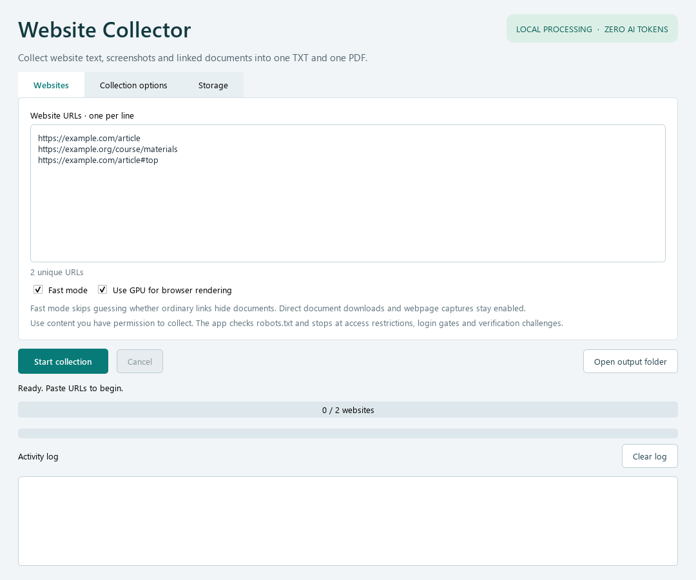

# Website Collector

**Turn a list of web pages into one tidy text file and one PDF — on your own Windows PC.**

Website Collector is a Windows desktop app. You paste website addresses, press **Start collection**, and it saves:

- `website_content.txt` — the readable text of every page, useful links, and the text of linked documents
- `website_content.pdf` — full-page screenshots of every page, the main images, and the actual pages of linked PDF/Word/PowerPoint files, with bookmarks

Everything runs locally. There is **no AI service, no account, and no API key**.



---

## Contents

- [Features](#features)
- [Requirements](#requirements)
- [Installation (beginner guide for Windows)](#installation-beginner-guide-for-windows)
  - [Option A — Download the ready-to-run app](#option-a--download-the-ready-to-run-app-easiest)
  - [Option B — Run from source code](#option-b--run-from-the-source-code)
- [How to use it](#how-to-use-it)
- [Settings explained](#settings-explained)
- [Where files are stored](#where-files-are-stored)
- [Optional: LibreOffice for Word and PowerPoint pages](#optional-libreoffice-for-word-and-powerpoint-pages)
- [Troubleshooting](#troubleshooting)
- [Limitations](#limitations)
- [Responsible use](#responsible-use)
- [Privacy](#privacy)
- [For developers](#for-developers)
- [License](#license)

---

## Features

- **Batch collection** — paste many URLs (one per line); duplicates and blank lines are ignored.
- **One TXT + one PDF per run** — each run gets its own dated folder, so earlier results are never overwritten.
- **Real browser screenshots** — pages are rendered with Chromium (via Playwright), so JavaScript-built content is included. Long pages are split into readable sections.
- **Clean text extraction** — headings, paragraphs, lists, tables and image captions are kept; menus, footers, scripts, hidden text and obvious cookie/ad blocks are removed from the TXT.
- **Linked documents** — PDF, DOCX, PPTX (and DOC/PPT with LibreOffice) are downloaded, their text goes into the TXT and their pages go into the PDF.
- **Images** — content images above a minimum size are added to the PDF; small logos, icons and trackers are skipped.
- **Unicode** — English, Bengali/Bangla, Hindi and other languages are saved as UTF-8.
- **Fast mode** (on by default) and optional **GPU-accelerated rendering**.
- **Polite by design** — respects `robots.txt` and crawl delays, never logs in, never solves CAPTCHAs, never bypasses paywalls.
- **Cancel any time** — a partial TXT/PDF is still saved and clearly labelled.
- **Optional link following** — follow same-site links to a chosen depth and limit (off by default).

---

## Requirements

| | |
| --- | --- |
| Operating system | Windows 10 or Windows 11, **64-bit** |
| Disk space | About 1 GB free (app + browser), plus room for your collections |
| Internet | Needed for setup and, of course, to collect websites |
| Python | **Only for Option B.** 64-bit Python 3.11, 3.12, 3.13 or 3.14 |
| Optional | [LibreOffice](https://www.libreoffice.org/download/) — adds Word/PowerPoint *pages* to the PDF and reads old `.doc`/`.ppt` files |

---

## Installation (beginner guide for Windows)

### Option A — Download the ready-to-run app (easiest)

No Python or programming tools needed.

1. Go to this repository's **[Releases](../../releases)** page (on the right side of the GitHub page).
2. Under the newest release, open **Assets** and download `WebsiteCollector-<version>-windows-x64.zip`.
3. Right-click the downloaded ZIP → **Extract All…** → choose a folder **you own**, for example
   `C:\Users\<you>\Documents\WebsiteCollector` or `D:\WebsiteCollector`.
   > ⚠️ Do **not** extract into `C:\Program Files`. The app saves its data next to itself and needs write access.
4. Open the extracted folder and double-click **`WebsiteCollector.exe`**.
5. If Windows shows **"Windows protected your PC"** (SmartScreen), click **More info → Run anyway**. This appears because the app is not code-signed by a paid certificate; it is not a virus warning specific to this app. Only do this if you downloaded the ZIP from this repository's Releases page.

That's it. If the release does not include a bundled Chromium browser, the app automatically uses Microsoft Edge, which is already installed on Windows 10/11.

### Option B — Run from the source code

Use this if there is no release yet, or if you want to change the code.

**Step 1 — Install Python (one time)**

1. Open <https://www.python.org/downloads/windows/> and download the latest **Windows installer (64-bit)** for Python 3.11–3.14.
2. Run the installer. On the first screen, tick **"Add python.exe to PATH"**, then click **Install Now**.
3. When it says *Setup was successful*, close it.

**Step 2 — Download Website Collector**

- *Without Git:* on this repository's main page click the green **Code** button → **Download ZIP**. Right-click the ZIP → **Extract All…** into a folder you own (for example `Documents\WebsiteCollector`).
- *With Git:* `git clone https://github.com/tahsinurrahman21-bit/WebsiteCollector.git`

Make sure `setup.bat` is directly inside the folder you open (not inside another sub-folder).

**Step 3 — Run setup (one time, about 5–10 minutes)**

1. Double-click **`setup.bat`**.
2. A black window opens and downloads everything the app needs (Python packages and the Chromium browser) **into this folder only**. You don't need to type anything.
3. Wait until it says **"Setup finished. Double-click run.bat to open Website Collector."** Press any key to close.

**Step 4 — Start the app**

- Double-click **`run.bat`**. Keep the small black launcher window open while you use the app.

You only need `setup.bat` once. Afterwards, just use `run.bat`. You can run `check_setup.bat` at any time to see whether all components are present, and run `setup.bat` again to repair an installation.

<details>
<summary>Python is installed in an unusual place?</summary>

Open PowerShell in the project folder and run:

```powershell
powershell -NoProfile -ExecutionPolicy Bypass -File .\setup.ps1 -Python "D:\Python311\python.exe"
```
</details>

---

## How to use it

1. **Websites tab** — paste one URL per line.
2. Leave **Fast mode** on unless you need deeper document discovery or very slow pages.
3. Optionally adjust **Collection options** and **Storage** (the defaults are sensible).
4. Click **Start collection**. Progress, elapsed time and a detailed activity log are shown.
5. When it finishes, click **Open output folder**.

Each run creates a new folder such as:

```text
output\2026-10-02_20-00-00_a1b2c3d4\
    website_content.txt
    website_content.pdf
```

Click **Cancel** to stop early. What was already collected is saved as a partial TXT/PDF labelled *cancelled*. The current browser action or PDF save may take a few seconds to finish.

---

## Settings explained

**Collection options** tab (defaults shown):

| Setting | Default | What it does |
| --- | --- | --- |
| Include images / PDF / PPT(X) / DOC(X) | On | Which resources to download |
| Follow linked webpages | Off | Also collect same-site pages linked from your URLs |
| Fast mode | On | Skips slow "is this link secretly a document?" checks and uses shorter waits |
| Use GPU for browser rendering | On | Lets Chromium use your graphics card for rendering only |
| Maximum individual download | 250 MB | Larger files are stopped |
| Page / connection timeout | 30 s | How long to wait for a page or server |
| Extra wait for page content | 2 s | Increase for slow JavaScript sites |
| Minimum image size | 250 × 150 px | Smaller images are skipped |
| Images / documents per website | 30 / 40 | Upper limits per site |
| Check untyped links for documents | 50 | Only used with fast mode off; 0 disables |
| Concurrent downloads | 4 | Parallel resource downloads |
| Extra webpages / link depth | 20 / 1 | Only when following links |
| Maximum capture sections | 60 | Stops endless pages |
| Document conversion timeout | 120 s | Per LibreOffice conversion |
| LibreOffice | auto-detect | Path to `soffice.com`/`soffice.exe` |

Your choices are saved in `settings.json` next to the app.

---

## Where files are stored

By default everything stays inside the app folder, so you can delete the whole folder to remove the app completely:

```text
WebsiteCollector\
    output\        Your collections (one folder per run)  ← keep this
    logs\          Detailed logs and a JSON report per run
    cache\         Downloaded pages, images and documents
    temp\          Temporary browser / conversion files
    browser_data\  Chromium browser + a fresh, separate profile per run
    settings.json  Your saved options
    last_urls.txt  The URLs from your last run (so you can reuse them)
```

The **Storage** tab lets you move output, cache, temp, browser-profile and log folders to another drive. The app never deletes your earlier outputs. There is no automatic cache cleanup — to free space, close the app and delete old folders inside `cache`, `temp`, `logs` and `browser_data\profiles` (keep `browser_data\browsers`).

---

## Optional: LibreOffice for Word and PowerPoint pages

Without LibreOffice, the app still extracts **text** from DOCX and PPTX files and includes PDF pages. With LibreOffice it can also:

- put Word pages and PowerPoint slides into the combined PDF, and
- read text from old `.doc` and `.ppt` files.

1. Download the Windows 64-bit installer from the [official LibreOffice site](https://www.libreoffice.org/download/) and install it normally.
2. The app detects standard installations automatically. If not, open **Collection options → LibreOffice → Browse** and select `...\LibreOffice\program\soffice.com`.

You never need to open LibreOffice yourself; the app runs it in the background with macros disabled. Advanced users can also place a LibreOffice installation in a `tools\LibreOffice` folder inside the app folder, which is detected automatically.

---

## Troubleshooting

| Problem | What to do |
| --- | --- |
| `setup.bat` says Python was not found | Install 64-bit Python 3.11–3.14 (see Option B, Step 1) and tick *Add python.exe to PATH*. Then run `setup.bat` again. |
| `run.bat` says *Please double-click setup.bat first* | Setup has not completed. Run `setup.bat` and wait for *Setup finished*. |
| Setup fails while downloading packages or the browser | Check your internet connection, firewall or proxy, then run `setup.bat` again. If Chromium still fails, the app can use Microsoft Edge instead. |
| *Windows protected your PC* | Click **More info → Run anyway** (only for files from this repository). |
| *Storage unavailable* message at start | The folder is not writable or the drive is disconnected. Move the app to a folder you own (e.g. Documents) or choose another location in the dialog. |
| The PDF has no screenshot for a site | Read that site's notes in the TXT/log. The site may block automated access, need a login, or loading may have timed out. Try increasing the timeout. |
| *Could not verify robots.txt … getaddrinfo failed* | A DNS / internet problem. Check that the address opens in your normal browser and try again. The app retries once automatically. |
| A URL is skipped because of robots.txt | The website asks automated tools not to collect it. The app respects that by design. |
| A linked document was missed | Turn **Fast mode off** and raise *Check untyped links for documents*. Some sites only offer a "Download" button, which the app does not click. |
| Content appears late or is missing | Turn fast mode off and increase *Extra wait* and *Page timeout*. |
| Word/PowerPoint pages missing from the PDF | Install LibreOffice (see above). |
| A scanned PDF has no text in the TXT | OCR is not supported; its pages are still in the PDF. |
| Collection is too large / slow | Lower the image, document and capture limits, keep link following off, or collect fewer URLs per run. |
| Strange characters in the TXT | Open it with a UTF-8 aware editor (Notepad on Windows 10/11 is fine). |
| Anything else | Run `check_setup.bat` (source version) and look at the newest file in `logs\`. When opening a GitHub issue, remove any private URLs from what you paste. |

---

## Limitations

- **Windows only.** The code uses Windows-specific APIs and batch scripts.
- **No login, forms or clicks.** Pages behind logins, paywalls, CAPTCHAs, cookie walls or "click to download" buttons may be incomplete.
- **Respects robots.txt strictly.** If a site's robots.txt cannot be fetched, that URL is skipped.
- **No OCR** for scanned documents; **no video or audio** download/transcription.
- **Embedded frames (iframes)** and content loaded through POST requests are not collected.
- SVG and CSS background images appear in screenshots but are not extracted separately.
- Screenshots show the site as rendered, including any cookie banners.
- Office-to-PDF conversion (LibreOffice) can look slightly different from Microsoft Office.
- PDF form fields, annotations and links from source documents are not kept in the combined PDF.
- No automatic cache cleanup; heavy use will grow the `cache`, `logs` and `browser_data` folders.
- GPU acceleration only affects browser rendering — downloads, text extraction and PDF building run on the CPU.

---

## Responsible use

Only collect content you are allowed to access and process, and follow each website's terms of use and copyright. The app identifies itself with the user agent `WebsiteCollector/1.0 (local desktop content collector)`, honours robots.txt and crawl delays, and does not import your personal browser cookies, log in, solve CAPTCHAs, or evade access controls. Collected content remains the property of its owners — do not republish it without permission.

---

## Privacy

- No data is sent anywhere except the requests to the websites you collect.
- No telemetry, analytics, accounts or API keys.
- Your URLs, collected content, logs and settings stay on your PC inside the app folder. **Do not commit these folders to a public repository** — the included `.gitignore` already excludes them.

---

## For developers

```text
app/
    main.py             Entry point (argument --root selects the data folder)
    gui.py              PySide6 (Qt) user interface
    crawler.py          Orchestrates a collection run
    browser.py          Playwright/Chromium rendering and screenshots
    network.py          HTTP client, robots.txt, crawl delays, downloads
    extract.py          HTML → clean text and links
    document_parser.py  PDF / DOCX / PPTX / DOC / PPT handling
    pdf_builder.py      Combined PDF assembly (PyMuPDF)
    urls.py, models.py, config.py, diagnostics.py, install_browser.py
tests/test_collector.py Offline test-suite with a local HTTP fixture server
packaging/              PyInstaller launcher and spec for the standalone build
build_release.ps1       Builds the Windows release ZIP
```

- **Run tests:** `run_tests.bat` (uses only local fixtures; browser tests need Chromium or Edge).
- **Run manually:** `.venv\Scripts\python.exe -m app.main --root .`
- **Dependencies:** `requirements.txt` lists supported ranges; `requirements-lock.txt` lists the exact tested versions used by `setup.bat`.
- **Build the standalone app:** see [docs/RELEASING.md](docs/RELEASING.md).

Bug reports and pull requests are welcome. Please don't attach logs or outputs that contain private URLs or third-party content.

---

## License

Website Collector's own source code is licensed under the **GNU Affero General Public License v3.0** — see [LICENSE](LICENSE). This choice keeps the project compatible with PyMuPDF, which is AGPL-licensed.

Third-party components (PySide6/Qt, Playwright, Chromium, PyMuPDF, LibreOffice and others) are **not** owned by this project and remain under their own licenses — see [THIRD_PARTY_NOTICES.md](THIRD_PARTY_NOTICES.md).
